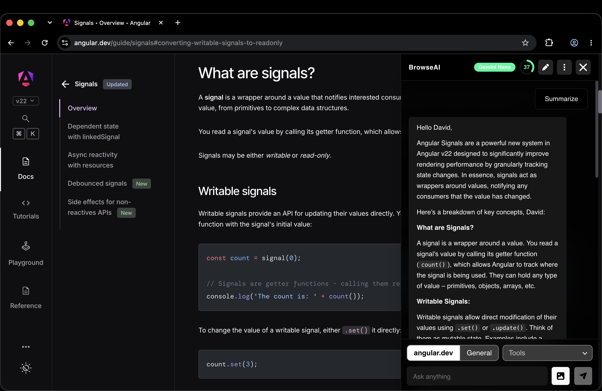
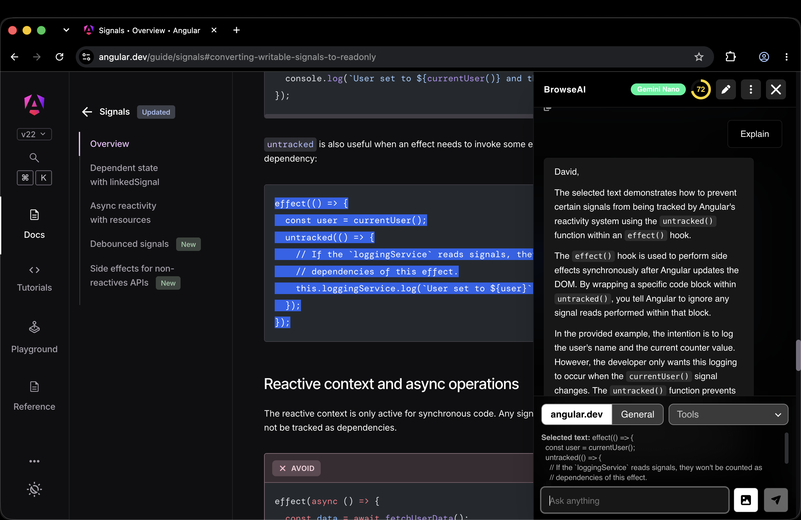
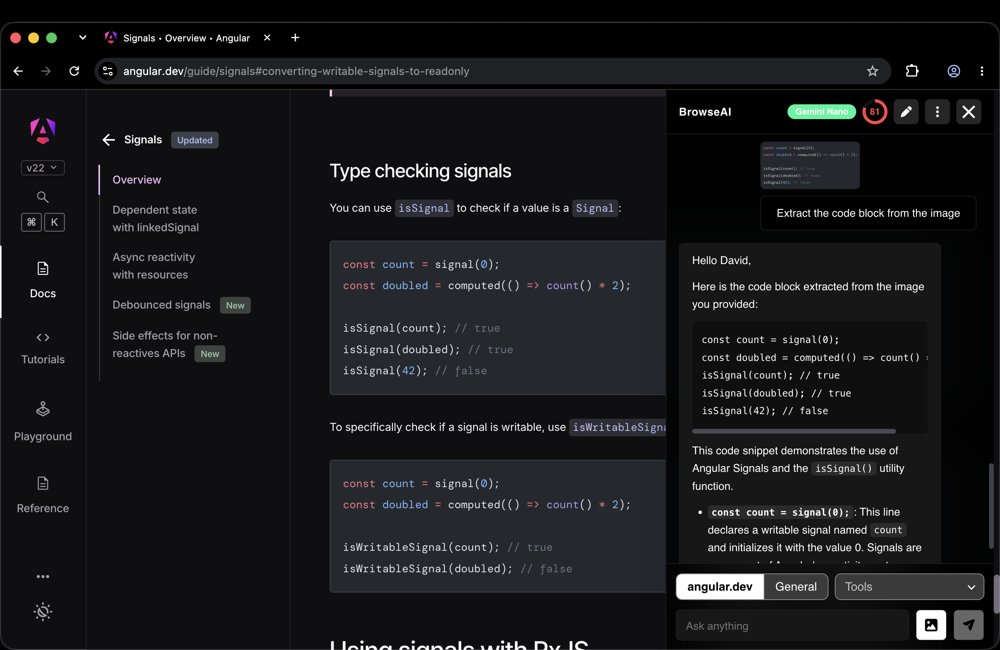
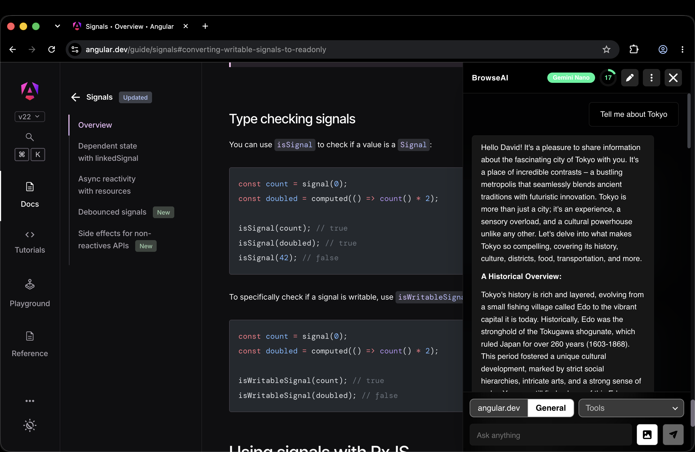
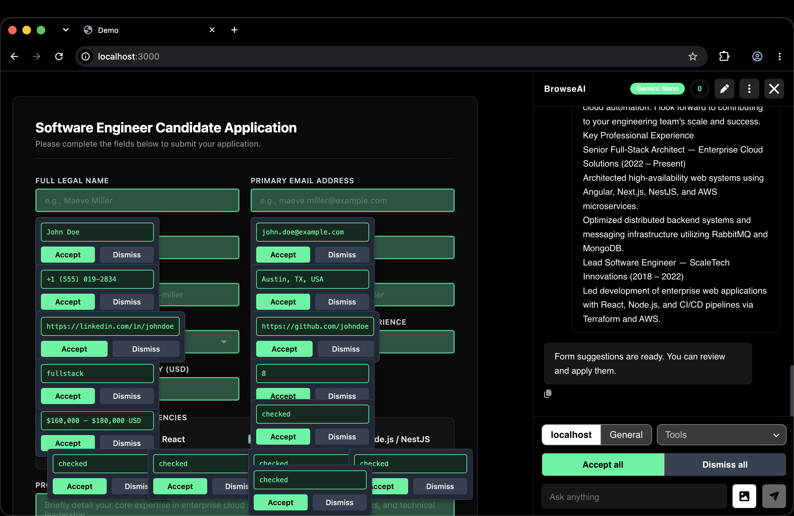

# BrowseAI

[](https://youtu.be/c3ZOUwcaTu0)

Watch the [demo on YouTube](https://youtu.be/c3ZOUwcaTu0).

Install it from the
[Chrome Web Store](https://chromewebstore.google.com/detail/browseai/dgbhpfghmnipbilehfelfliihmgombch).

A Chrome extension that adds an AI chat to every web page. It runs on Chrome's
built-in model (Gemini Nano), so pages and prompts stay on your device.

The chat itself is the
[browse-ai-core](https://www.npmjs.com/package/browse-ai-core) npm package. This
repo only wires it into Chrome:

- `src/main.ts` and `src/content/`: the content script. It adds a
  `<browse-ai-extension>` element to the page and mounts the chat in it with the
  extension settings from `src/content/extension-config.ts`.
- `src/background/`: the service worker. It takes screenshots of the tab when
  the chat asks for one.
- `public/`: `manifest.json` and the toolbar popup.

To change how the chat looks or works, change the package, publish it, and
update the version here.

## Docs

Architecture, features, decisions, development, release, the store listing and
the privacy policy are in [docs/](docs/README.md).

## Development

```console
npm install
npm start          # rebuilds dist/browse-ai on every change
```

Open `chrome://extensions`, turn on developer mode, click "Load unpacked" and
pick `dist/browse-ai`. Reload the extension after a rebuild.

## Tests

```console
npm test
```

## Release

```console
./publish.sh
```

It runs the tests and creates `browseai-extension.zip` with `manifest.json` at
its root. Upload the zip in the Chrome Web Store developer dashboard. The store
texts and checklist are in [docs/release.md](docs/release.md).

## Icons

The icons in `images/icon` were made with https://www.appicongenerator.ad.

## Demo screenshots










